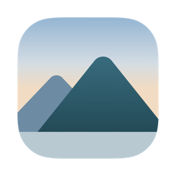
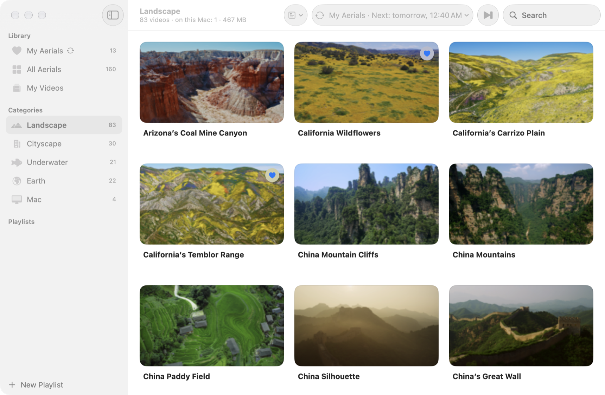
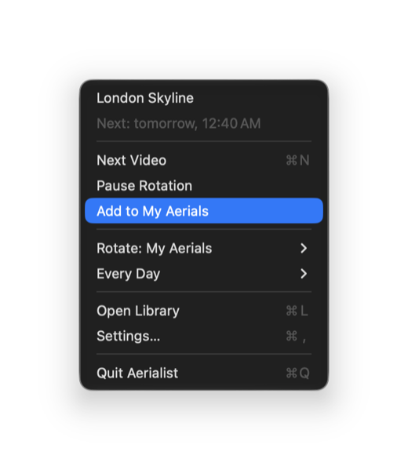
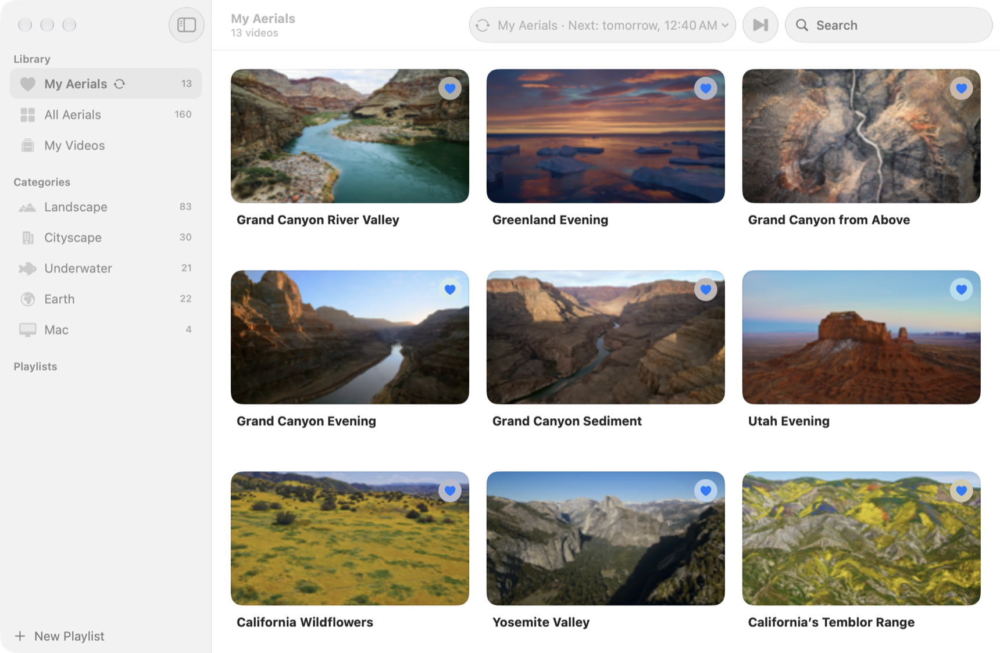

<div align="center">



<h1>Aerialist</h1>

<p><b>Your favorite Apple aerials on rotation, without macOS downloading all 160.</b></p>

<p>macOS Shuffle quietly downloads every aerial video, up to 1.5 GB each.<br>
Aerialist rotates the ones you pick and keeps only the last few on disk.<br>
Free, for macOS 26 Tahoe or later.</p>

<p>
  <a href="https://github.com/eddytwist/aerialist/releases/latest/download/Aerialist.dmg"></a>
</p>

<p>
  
  <a href="https://github.com/eddytwist/aerialist/releases/latest"></a>
  <a href="LICENSE"></a>
</p>

<picture>
  <source media="(prefers-color-scheme: dark)" srcset="docs/screenshots/category-dark.png">
  <source media="(prefers-color-scheme: light)" srcset="docs/screenshots/category-light.png">
  
</picture>

</div>

## Features

- **My Aerials.** Pick favorites from all 160 Apple aerials with ＋ on a tile; they rotate every 3 hours to once a
  week, with no repeats. A playlist, a category, all aerials or one video can rotate instead.
- **No pile-up on your disk.** Each video is downloaded right before its turn, and only the last 1, 3, 5 or 10
  shown stay. macOS Shuffle stays off, so nothing else lands on your disk.
- **Keep on This Mac** the ones you want offline; without the network, the videos already on disk rotate.
- **Add your own videos.** Drop in clips or folders; they rotate with Apple's and appear in System Settings →
  Wallpaper.
- **Undo anytime.** Your wallpaper settings are backed up first, and **Restore…** brings them back.

<table>
  <tr>
    <td width="38%" align="center">
      
      <p><sub>Everything from the menu bar</sub></p>
    </td>
    <td width="62%" align="center">
      <picture>
        <source media="(prefers-color-scheme: dark)" srcset="docs/screenshots/library-dark.png">
        
      </picture>
      <p><sub>Make a playlist to rotate</sub></p>
    </td>
  </tr>
</table>

## Install

1. [Download **Aerialist.dmg**](https://github.com/eddytwist/aerialist/releases/latest/download/Aerialist.dmg),
   open it and drag **Aerialist** to Applications.
2. Open Aerialist. macOS says it can't verify the app: click **Done**.
3. Open **System Settings → Privacy & Security**, scroll down and click **Open Anyway**. You do this once.
4. The library opens and a mountain appears in the menu bar.

Step 3 is there because the app isn't notarized by Apple yet. Updates install from inside the app, so you do
this only once.

**Requirements:** macOS 26 Tahoe or later, Apple Silicon or Intel. App in English and Russian.

## FAQ

<details>
<summary><b>How is it different from <a href="https://github.com/AerialScreensaver/Aerial">Aerial</a>?</b></summary>

Aerial is a screen saver with its own player and video sources. Aerialist doesn't play anything itself: it uses the
wallpaper and screen saver built into macOS and decides which videos they show.

</details>

<details>
<summary><b>Is it safe? What does it change?</b></summary>

macOS keeps the wallpaper choice in a settings file. Aerialist writes one video ID into it and restarts the
wallpaper service, so the desktop may flicker for a moment. Every change is backed up, read back and checked, and the
previous settings come back if macOS doesn't accept it. Videos come only from Apple's servers, and app updates only
from this repository's GitHub releases.

</details>

<details>
<summary><b>What stays on my disk?</b></summary>

When it's time to change, Aerialist downloads the next video from Apple if it isn't on this Mac, sets it as the
wallpaper, and only then deletes what fell out of the last N shown (Settings → Storage → **Keep the Last**:
1, 3, 5 or 10). Turn off **Delete Shown Aerials** to keep everything that was shown.

- **Traffic:** each change downloads 0.04–1.5 GB, about 0.5 GB on average; once a day is about 15 GB a month.
  Keeping more videos saves traffic only when My Aerials is that small; otherwise each video comes back after a
  full round anyway.
- **No network, Low Data Mode or Low Power Mode:** a scheduled change shows a video from your rotation that is
  already on disk. **Next Video** downloads anyway, because you asked for it. A half-downloaded file is never kept.
- **Never deleted:** videos you **Keep on This Mac**, your own videos, and any video a display, Space, the screen
  saver or the lock screen still uses. Settings → Storage → **On This Mac → Show…** lists every file.
- Turning deletion on asks first about videos already on disk; lowering N asks first if more than one would go.
- Copies the rotation downloaded are deleted for good, so they don't fill the Trash; your earlier downloads go to
  the Trash.

</details>

<details>
<summary><b>What if I change the wallpaper in System Settings?</b></summary>

Rotation pauses and the menu says why; **Resume Rotation** picks up from there. If you turn on macOS Shuffle, the menu
offers to switch back.

</details>

<details>
<summary><b>Screen saver, several displays, Spaces?</b></summary>

If your screen saver follows the wallpaper (the macOS default), it changes too. Aerialist changes the wallpaper
shared by all displays and Spaces; ones with their own wallpaper keep it.

</details>

<details>
<summary><b>What's the catch with my own videos?</b></summary>

macOS shows them through two preference keys Apple doesn't document. If an update stops honoring them, your videos
disappear from System Settings; Apple's aren't affected. You can turn them off in Settings at any time. Aerialist
works on copies, so your originals stay where they are.

</details>

<details>
<summary><b>How much has macOS already downloaded?</b></summary>

```bash
du -sh ~/Library/Application\ Support/com.apple.wallpaper/aerials/videos
```

And when it downloaded them in the background:

```bash
log show --last 7d --predicate 'process == "WallpaperAerialsExtension" AND eventMessage CONTAINS "in the background"' --style compact
```

</details>

<details>
<summary><b>Keyboard shortcuts</b></summary>

| Shortcut | Action |
|---|---|
| <kbd>←</kbd> <kbd>→</kbd> <kbd>↑</kbd> <kbd>↓</kbd> | Move the selection |
| <kbd>Space</kbd> | Quick Look |
| <kbd>Return</kbd> | Set as wallpaper (downloads it first if needed) |
| <kbd>⌘</kbd> <kbd>⌫</kbd> | Move to the Trash |

</details>

<details>
<summary><b>How do I uninstall it?</b></summary>

1. If you added your own videos, turn off **Show My Videos in macOS** in Settings.
2. Settings → **Original Wallpaper** → **Restore…**, if you want your old wallpaper back.
3. Turn off **Open at Login**, quit Aerialist and move it to the Trash.

Downloaded videos belong to macOS and stay where System Settings can use them.

Already removed the app with My Videos on? These put macOS back on Apple's catalog:

```bash
defaults delete com.apple.wallpaper.aerial AerialManifestLocalPathOverride
```

```bash
defaults delete com.apple.wallpaper.aerial AerialManifestForceLocal
```

```bash
killall WallpaperAerialsExtension
```

</details>

## Privacy

No accounts, no analytics. The app goes online for two things:

- **Videos, from Apple's servers:** the next video before each change when it isn't on this Mac, and when you set
  one as the wallpaper or keep it on this Mac.
- **Updates, from GitHub:** at first launch and then once a day it downloads a small file from this repository's
  latest release to see if there's a newer version. Nothing pops up: the menu and Settings offer **Update to …**,
  and only when you click it does the app download the new version from the same place. It sends nothing else;
  like any download, GitHub sees your IP address and the app's name and version. Turn the daily check off in
  Settings → Updates, or check by hand with **Check for Updates…**.

Every update is signed: the app installs it only if the signature matches the key built into it. The aerial
videos, their names and previews belong to Apple; Aerialist doesn't include or redistribute them and isn't
affiliated with Apple.

<details>
<summary><b>For developers</b></summary>

Build from source with the Command Line Tools (`xcode-select --install`), no Xcode needed:

```bash
git clone https://github.com/eddytwist/aerialist.git && cd aerialist && scripts/build-app.sh --install
```

```bash
scripts/test.sh
```

`scripts/build-app.sh --universal --dmg` makes a disk image; `scripts/release.sh` also signs it and writes the update
feed, which needs the maintainer's update signing key. `aerialctl` is a command line tool on the same
core (`swift run aerialctl status`); its `next` switches only to downloaded videos, and it also has `custom off`, which puts macOS back on Apple's catalog if the app was
removed with My Videos on.

</details>

## License

[MIT](LICENSE) © 2026 Eduard Ivanov · [eddytwist.com](https://eddytwist.com)
