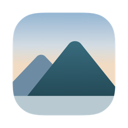
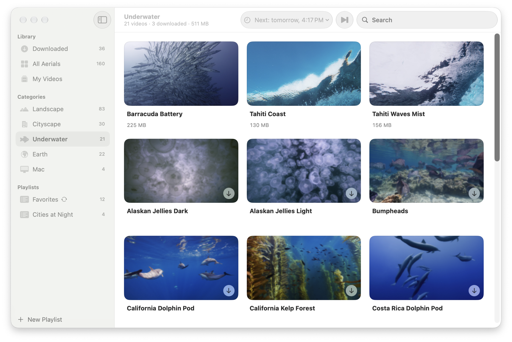
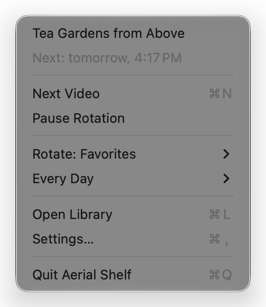
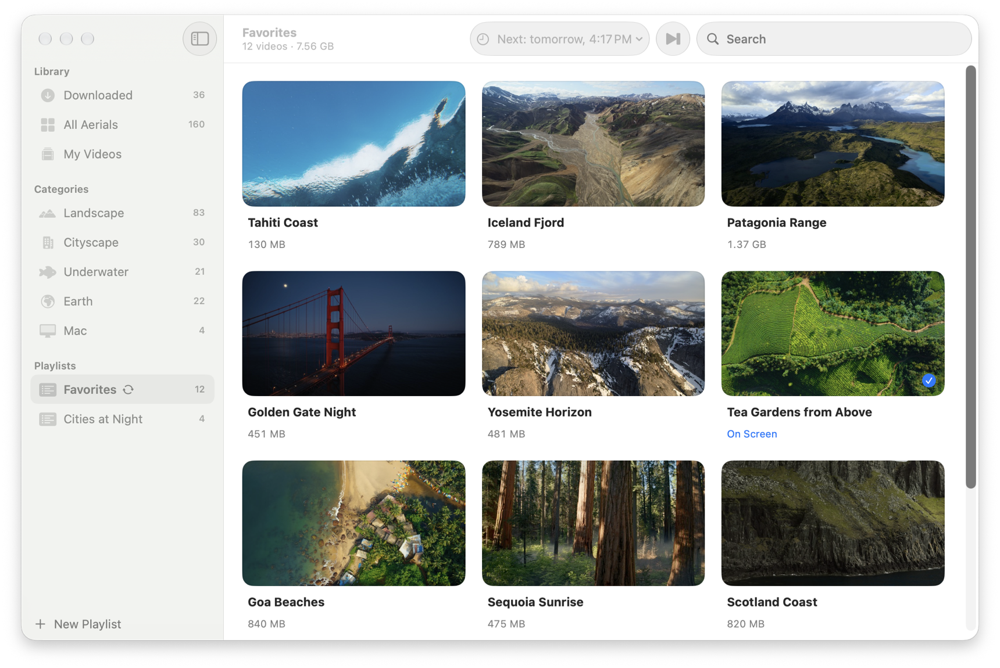

<div align="center">



<h1>Aerial Shelf</h1>

<p><b>Your favorite Apple aerials on rotation, without macOS downloading all 160.</b></p>

<p>macOS Shuffle quietly downloads every aerial video, up to 1.5 GB each.<br>
Aerial Shelf downloads only the ones you pick and rotates just those. Free, for macOS 26 Tahoe or later.</p>

<p>
  <a href="https://github.com/eddytwist/aerial-shelf/releases/latest/download/AerialShelf.dmg"></a>
</p>

<p>
  
  <a href="https://github.com/eddytwist/aerial-shelf/releases/latest"></a>
  <a href="LICENSE"></a>
</p>

<picture>
  <source media="(prefers-color-scheme: dark)" srcset="docs/screenshots/category-dark.png">
  <source media="(prefers-color-scheme: light)" srcset="docs/screenshots/category-light.png">
  
</picture>

</div>

## Features

- **Download only what you pick.** All 160 Apple aerials by category, with each video's size shown before you
  download it.
- **Rotate just those.** All your downloads, a playlist or one video, every 3 hours to once a week, with no repeats.
  macOS Shuffle stays off, so nothing else lands on your disk.
- **Add your own videos.** Drop in clips or folders; they rotate with Apple's and appear in System Settings →
  Wallpaper.
- **Undo anytime.** Your wallpaper settings are backed up first, and **Restore…** brings them back.

<table>
  <tr>
    <td width="38%" align="center">
      
      <p><sub>Everything from the menu bar</sub></p>
    </td>
    <td width="62%" align="center">
      <picture>
        <source media="(prefers-color-scheme: dark)" srcset="docs/screenshots/library-dark.png">
        
      </picture>
      <p><sub>Make a playlist to rotate</sub></p>
    </td>
  </tr>
</table>

## Install

1. [Download **AerialShelf.dmg**](https://github.com/eddytwist/aerial-shelf/releases/latest/download/AerialShelf.dmg),
   open it and drag **Aerial Shelf** to Applications.
2. Open Aerial Shelf. macOS says it can't verify the app: click **Done**.
3. Open **System Settings → Privacy & Security**, scroll down and click **Open Anyway**. You do this once.
4. The library opens and a mountain appears in the menu bar.

Step 3 is there because the app isn't notarized by Apple yet.

**Requirements:** macOS 26 Tahoe or later, Apple Silicon or Intel. macOS 14 and 15 keep aerials in a different place
and download them with a different system service, so Aerial Shelf doesn't run there. English and Russian.

## FAQ

<details>
<summary><b>How is it different from <a href="https://github.com/AerialScreensaver/Aerial">Aerial</a>?</b></summary>

Aerial is a screen saver with its own player and video sources. Aerial Shelf doesn't play anything itself: it uses the
wallpaper and screen saver built into macOS and decides which videos they show.

</details>

<details>
<summary><b>Is it safe? What does it change?</b></summary>

macOS keeps the wallpaper choice in a settings file. Aerial Shelf writes one video ID into it and restarts the
wallpaper service, so the desktop may flicker for a moment. Every change is backed up, read back and checked, and the
previous settings come back if macOS doesn't accept it. Downloads come only from Apple's servers.

</details>

<details>
<summary><b>What if I change the wallpaper in System Settings?</b></summary>

Rotation pauses and the menu says why; **Resume Rotation** picks up from there. If you turn on macOS Shuffle, the menu
offers to switch back.

</details>

<details>
<summary><b>Screen saver, several displays, Spaces?</b></summary>

If your screen saver follows the wallpaper (the macOS default), it changes too. Aerial Shelf changes the wallpaper
shared by all displays and Spaces; ones with their own wallpaper keep it.

</details>

<details>
<summary><b>What's the catch with my own videos?</b></summary>

macOS shows them through two preference keys Apple doesn't document. If an update stops honoring them, your videos
disappear from System Settings; Apple's aren't affected. You can turn them off in Settings at any time. Aerial Shelf
works on copies, so your originals stay where they are.

</details>

<details>
<summary><b>How much has macOS already downloaded?</b></summary>

```bash
du -sh ~/Library/Application\ Support/com.apple.wallpaper/aerials/videos
```

And when it downloaded them in the background:

```bash
log show --last 7d --predicate 'process == "WallpaperAerialsExtension" AND eventMessage CONTAINS "in the background"' --style compact
```

</details>

<details>
<summary><b>Keyboard shortcuts</b></summary>

| Shortcut | Action |
|---|---|
| <kbd>←</kbd> <kbd>→</kbd> <kbd>↑</kbd> <kbd>↓</kbd> | Move the selection |
| <kbd>Space</kbd> | Quick Look |
| <kbd>Return</kbd> | Set as wallpaper, or download |
| <kbd>⌘</kbd> <kbd>⌫</kbd> | Move to the Trash |

</details>

<details>
<summary><b>How do I uninstall it?</b></summary>

1. If you added your own videos, turn off **Show My Videos in macOS** in Settings.
2. Settings → **Original Wallpaper** → **Restore…**, if you want your old wallpaper back.
3. Turn off **Open at Login**, quit Aerial Shelf and move it to the Trash.

Downloaded videos belong to macOS and stay where System Settings can use them.

Already removed the app with My Videos on? These put macOS back on Apple's catalog:

```bash
defaults delete com.apple.wallpaper.aerial AerialManifestLocalPathOverride
```

```bash
defaults delete com.apple.wallpaper.aerial AerialManifestForceLocal
```

```bash
killall WallpaperAerialsExtension
```

</details>

## Privacy

No accounts, no analytics. The app goes online only when you click Download, and only to Apple's servers. The aerial
videos, their names and previews belong to Apple; Aerial Shelf doesn't include or redistribute them and isn't
affiliated with Apple.

<details>
<summary><b>For developers</b></summary>

Build from source with the Command Line Tools (`xcode-select --install`), no Xcode needed:

```bash
git clone https://github.com/eddytwist/aerial-shelf.git && cd aerial-shelf && scripts/build-app.sh --install
```

```bash
scripts/test.sh
```

`scripts/build-app.sh --universal --dmg` makes the release disk image. `aerialctl` is a command line tool on the same
core (`swift run aerialctl status`); it also has `custom off`, which puts macOS back on Apple's catalog if the app was
removed with My Videos on.

</details>

## License

[MIT](LICENSE) © 2026 Eduard Ivanov · [eddytwist.com](https://eddytwist.com)
